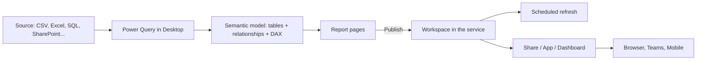

# 01 · What Power BI Is: Desktop, Service & Mobile

"Power BI" is not one program. It is a family of tools that share one core idea: you
build a **semantic model** (tables, relationships, and calculations) once, and many
reports and people query it. Knowing which piece does what saves a lot of confusion,
because a feature that exists in one piece is often missing or different in another.

## The pieces

| Piece | Where it runs | What you do there |
|-------|---------------|-------------------|
| **Power BI Desktop** | Windows application (free download) | Connect to data, transform it in Power Query, build the model, write DAX, design report pages. Produces a `.pbix` file (or a PBIP folder, covered in Level 4). |
| **Power BI service** | Browser, at app.powerbi.com | Publish, share, schedule refresh, apply security, build dashboards, organize content in workspaces and apps. |
| **Power BI Mobile** | iOS and Android apps | Read reports and dashboards, with layouts optimized for phones. |
| **Power BI Report Builder** | Windows application | Author *paginated* (pixel-perfect, printable) reports. Covered in Level 3. |
| **On-premises data gateway** | A Windows machine inside your network | Lets the cloud service refresh data that lives behind your firewall. Covered in Level 2. |
| **Power BI Report Server** | Your own servers | An on-premises alternative to the service for organizations that cannot use the cloud. It follows its own release cadence. |

There is also a tight relationship with **Microsoft Fabric**, a broader analytics
platform in which Power BI is one "experience." Level 4 discusses Fabric carefully; for
now, treat the Power BI service as the place your reports live.

## The vocabulary you need on day one

- **Semantic model** — the tables, relationships, measures and security roles that a
  report reads from. Older material and older menus call this a **dataset**; Microsoft
  renamed it, and you will see both terms.
- **Report** — one or more pages of interactive visuals bound to a single semantic
  model.
- **Dashboard** — a single canvas in the service made of *tiles pinned from reports*.
  It is not the same thing as a report page, even though people use the word loosely.
- **Workspace** — a container in the service that holds models, reports, dashboards and
  other items, with its own membership and roles.
- **App** — a packaged, read-only bundle of workspace content distributed to a wider
  audience.

## A typical flow

When you publish from Desktop, two items appear in the workspace: the semantic model and
the report. They are separate objects from that moment on. Other reports can connect to
the same model, which is how organizations avoid ten slightly different definitions of
"revenue."

## Licensing, in general terms

Microsoft's licensing changes over time and prices vary by region and agreement, so this
course does not quote prices. The shape of it is stable enough to understand:

- **Free** — you can use Desktop for authoring and a personal workspace in the service,
  but you cannot share content with others in the normal collaborative way.
- **Pro (per user)** — required for both the author who shares and, typically, each
  person who views shared content, unless that content sits in a capacity.
- **Premium Per User (PPU)** — a per-user license that unlocks many features normally
  associated with capacity (larger models, more refreshes, deployment pipelines and
  similar), but only among PPU-licensed users.
- **Capacity (Premium / Fabric capacity SKUs)** — the organization buys dedicated compute.
  Content in a capacity workspace can, depending on the capacity size and settings, be
  viewed by users without a per-user paid license, while authors still need one.

!!! warning "Check before you plan"
    The exact rules (which SKUs allow free viewers, size limits, refresh counts) have
    changed several times and are the kind of detail that goes stale. Before you design
    a rollout, read Microsoft's current licensing documentation or ask your tenant admin.

## Worked example: where does each task happen?

Imagine a sales manager says: "I want a revenue report that refreshes every morning, and
my regional leads should see only their region."

| Requirement | Where it is built |
|-------------|-------------------|
| Connect to the sales database and remove test orders | Power Query, in Desktop |
| Define `Total Revenue` once | DAX measure, in the model (Desktop) |
| Region leads see only their region | Security role defined in Desktop, users assigned in the service |
| Refresh every morning | Scheduled refresh settings in the service (plus a gateway if the database is on-premises) |
| Leads open it in Teams or on their phone | Service sharing/app; Mobile app |

Notice that almost nothing about the *requirement* is about chart types.

## How It Actually Works

When Power BI Desktop starts, it launches a local instance of the **Analysis Services
tabular engine** in the background (you can see a process named `msmdsrv.exe` in Task
Manager). That engine is the same technology behind SQL Server Analysis Services and
Azure Analysis Services. Your model lives inside it:

- Imported tables are stored in memory by the **VertiPaq** engine, a column-oriented,
  compressed store. Each column is encoded separately, which is why a table with a
  hundred million rows can fit in a few hundred megabytes when its columns repeat a lot.
- Every visual on a report page is turned into a **DAX query** and sent to that engine.
  The engine answers with a small result table, and the visual draws it. A bar chart of
  revenue by region does not "see" your rows; it sees three rows of results.
- Power Query runs in a separate mashup engine. It executes only when you load or
  refresh, and it writes rows *into* the tabular engine. Once loaded, Power Query plays
  no part in answering visuals.

When you publish, the `.pbix` file's model is uploaded and hosted by the service's
Analysis Services infrastructure, and the report definition is stored separately. That
separation is exactly why the service lists a semantic model and a report as two items.

Knowing this explains several things beginners find odd: why a report can be fast on a
large table (compressed columns, tiny result sets), why a change to a Power Query step
requires a refresh to show up, and why Desktop can use a lot of RAM.

## Common mistakes

- **Treating a dashboard and a report as the same thing.** Dashboards are pinned tiles in
  the service; you cannot build one in Desktop.
- **Building every report on its own copy of the data.** Ten `.pbix` files that each import
  the same sales table mean ten refreshes and ten chances for definitions to drift. Share
  one model when you can (Level 4 covers this).
- **Assuming the free license lets you share.** It does not in the ordinary sense;
  plan licenses before promising a rollout.
- **Expecting Desktop on a Mac.** Use a Windows VM, a Windows machine, or limit yourself to
  the service's web authoring features, which are narrower.

## Exercise

1. Install Power BI Desktop on a Windows machine. From **Help → About**, note the version
   and release month, so you know which release the rest of your work is on.
2. Open Task Manager while Desktop is running with a blank report and find the Analysis
   Services engine process. Note its memory use, then load the Level 1 sample CSV
   (next lesson) and compare.
3. For a report you use at work (or an imagined one), write a table like the worked
   example above: list five requirements and say which piece of Power BI each lives in.
