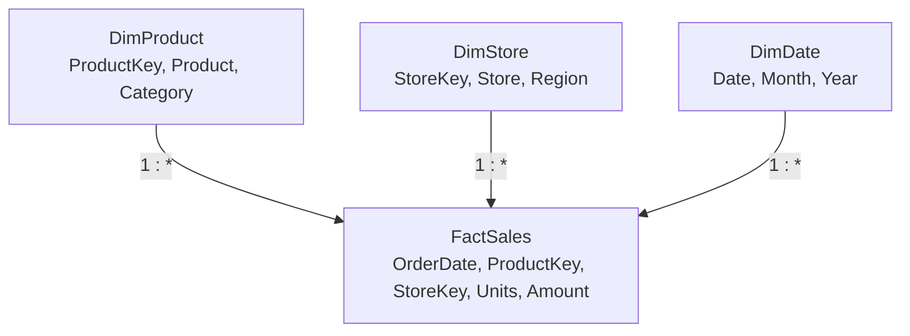

# 01 · Star Schema & Data Modeling

Level 1 used one flat table, and for eight rows that was fine. Real data doesn't arrive
like that, and even when it does, you shouldn't keep it that way. Power BI's engine,
its DAX functions, and its time-intelligence features are all designed around one shape:
the **star schema**.

## Facts and dimensions

- A **fact table** records events or measurements: one row per sale, per shipment, per
  hour of sensor readings. It has **keys** pointing to dimensions and **numeric columns** you
  aggregate (Units, Amount). It is long and narrow.
- A **dimension table** describes the things involved in the events: products, stores,
  customers, dates. One row per thing, with a unique key and many descriptive attributes
  (Category, Region, Manager). It is short and wide.

In the Level 2 sample, `FactSales` is the fact; `DimProduct`, `DimStore` (and soon
`DimDate`) are dimensions. Draw it and you get a star:



Filters (slicers on Category, Region, Month) sit on the dimensions; numbers come from the
fact. Everything flows one way: from the "one" side to the "many" side.

## Grain: the first design decision

The **grain** is what one row of the fact table means, stated in words: "one row per
order line" or "one row per store per day." Decide it before anything else, and never mix
grains in one fact table.

A classic mistake: a `Sales` table at order-line grain with a `MonthlyTarget` column
copied onto every line. Summing `MonthlyTarget` multiplies the target by the number of
lines. Targets are a different grain (store × month) and belong in their own fact table
(`FactTarget`), related to the same dimensions. Level 2's project does exactly this.

## Worked example: flat vs star

Flatten the sample into one table (each fact row with Product, Category, Store, Region
copied in). Two problems appear immediately:

1. **Camp Stove disappears.** It has no sales, so it has no row in the flat table. A
   product list, or a "products with no sales" check, can't be answered. In the star,
   `DimProduct` still contains it.
2. **Attribute changes are painful.** If Austin moves from South to Central, the flat table
   must update every Austin row; the star updates one row in `DimStore`.

Now count products per category, which only makes sense on the dimension:

```dax
Product Count = COUNTROWS ( DimProduct )
```

By Category: Camping **3** (Trail Tent, Sleeping Bag, Camp Stove), Apparel **1**,
Accessories **1**. In a flat fact table, `DISTINCTCOUNT(Product)` would give Camping 2,
because Camp Stove never sold — a different, and often wrong, answer.

## Building the star from a flat source

Often you receive a flat extract. Split it in Power Query:

1. Duplicate or **Reference** the flat query three times: `FactSales`, `DimProduct`,
   `DimStore`.
2. In `DimProduct`: keep only `Product`, `Category` columns → **Remove Duplicates** → add
   an index column (**Add Column → Index Column → From 1**) as `ProductKey`.
3. In `FactSales`: **Merge Queries** with `DimProduct` on `Product` (lesson 06 covers
   merges), expand only `ProductKey`, then remove `Product` and `Category`.
4. Repeat for stores.
5. Disable load on the original flat query (right-click → uncheck **Enable load**) so it
   isn't stored twice.

When the source is a proper warehouse, the dimensions usually already exist with
**surrogate keys** (integers generated by the warehouse). Use them — integer keys compress
better and join faster than text keys.

## Snowflakes and when to flatten

If `DimProduct` has a `SubcategoryKey` pointing to `DimSubcategory`, which points to
`DimCategory`, that's a **snowflake**. Power BI handles it, but each extra hop is another
relationship to traverse and more tables for report authors to wade through. The usual
advice: **flatten snowflaked dimensions** into one table in Power Query (merge Category
into Product), keeping the fact → dimension relationships single-hop.

## How It Actually Works

The star shape matches how the engine evaluates queries. A visual showing Amount by
Category is resolved like this:

1. The storage engine scans `DimProduct[Category]` to find which `ProductKey` values belong
   to each category (Camping → {1, 4, 5}).
2. The relationship `DimProduct[ProductKey] → FactSales[ProductKey]` turns that key list
   into a filter on the fact table. Internally, the relationship is stored as a mapping
   structure between the key column's values on both sides, so this step is a lookup,
   not a join over rows.
3. The engine scans `FactSales[Amount]` only for rows whose `ProductKey` is in the set and
   sums them: 240 + 120 + 190 + 95 = **645** for Camping.

Because dimension tables are small, step 1 is cheap. Because the fact table is only keys
and numbers, its columns compress extremely well (a `ProductKey` column with a few thousand
distinct integers across a hundred million rows compresses to a small fraction of its raw
size). A wide flat table repeats long text values — product names, region names — on
every row, and while dictionary encoding helps, you pay for more columns and more
distinct combinations in every scan.

DAX functions assume this layout as well: time intelligence expects a date *dimension*;
`ALL(DimProduct)` removes filters from a whole dimension in one go; and "show items with
no data" works on dimension rows that have no fact rows.

## Common mistakes

- **One giant table** because "it's easier." It is — for about a week.
- **Mixed grain** in one fact table (lines and monthly targets together).
- **Text keys** like `"DEN-2025-TENT"` joining big tables; use integer surrogate keys.
- **Dimension keys that aren't unique.** A duplicated `ProductKey` in `DimProduct` turns the
  relationship many-to-many and double-counts. Check with **Column distribution** in Power
  Query: distinct count must equal row count.

## Exercise

1. Create the three Level 2 tables with **Enter data** and relate them (next lesson covers
   the details; for now drag `ProductKey` and `StoreKey` from dimension to fact in Model
   view).
2. Build a table visual of Category with `Product Count` and `Total Amount =
   SUM(FactSales[Amount])`. Confirm 3/645, 1/320, 1/250.
3. Write the grain of each table in its **Description** property (select the table in
   Model view → Properties pane). Then describe the grain of a hypothetical `FactTarget`
   table.
