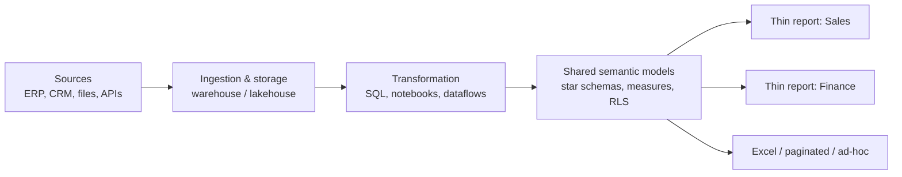

# 01 · Enterprise BI Architecture

A single analyst's Power BI file contains everything: connection, cleaning, model, measures and
report. That's fine for one person. At organizational scale it produces dozens of files each
importing the same tables and each defining "revenue" slightly differently. Enterprise
architecture is mostly about **separating those layers** so each is built once, owned by someone,
and reused.

## The layers

| Layer | Owns | Typical tools | Owner |
|-------|------|---------------|-------|
| Ingestion & storage | Raw and cleaned tables, history | Data warehouse, lakehouse, pipelines | Data engineering |
| Transformation | Business-ready dimensions and facts | SQL views, dbt-style transforms, Spark notebooks, dataflows | Data/analytics engineering |
| Semantic model | Relationships, measures, security, formatting | Power BI semantic models | BI / analytics engineering |
| Reports | Pages, visuals, narrative | Power BI reports (thin), paginated reports | Report authors, business analysts |

## "As far upstream as possible, as far downstream as necessary"

A widely quoted rule of thumb in the Power BI community: put transformation logic **as far
upstream as possible** (the warehouse, where it's reusable by every tool) and **as far downstream
as necessary** (DAX, only for what must respond to filters).

| Logic | Best home | Why |
|-------|-----------|-----|
| Deduplicating customers, conforming product codes | Warehouse / transformation layer | Every consumer needs it; SQL/Spark scale better than Power Query |
| Surrogate keys, slowly changing dimensions | Warehouse | Needs history and stable IDs |
| Renaming columns to business terms, hiding technical columns | Semantic model | Presentation of the model |
| Revenue, margin %, YTD, share of total | DAX measures | Must respond to filter context |
| "Top 10 products by selected metric" | DAX / report | Depends on user interaction |
| Light Power Query steps (type fixes, filters that fold) | Power Query | Acceptable when upstream can't change quickly |

## Shared semantic models and thin reports

A **thin report** is a report with no model of its own: it connects live to a published semantic
model (**Get data → Power BI semantic models**, or "OneLake data hub/catalog" in newer UIs). The
model is published once from its own `.pbix`/PBIP with no report pages (or a single documentation
page), and every report connects to it.

Benefits:

- One definition of each measure; fix a bug once.
- One refresh and one copy of the data in memory.
- RLS defined once, applied to every report.
- Report authors can't accidentally change the model.

Costs:

- Report authors depend on the model team for new measures (they can add *report-level* measures
  in a thin report, which should be temporary).
- Changes to the model affect every report — hence deployment pipelines, testing (lesson 09) and
  source control (lesson 07).

## Worked example: consolidating three files

A company has three reports, each importing the same sales tables:

| File | Model size | Revenue definition | Refreshes/day |
|------|-----------:|--------------------|--------------:|
| Sales Weekly.pbix | 400 MB | `SUM(Amount)` | 2 |
| Exec Dashboard.pbix | 380 MB | `SUM(Amount) - SUM(Returns)` | 4 |
| Regional Ops.pbix | 410 MB | `SUMX(Sales, Qty * Price)` | 1 |

That's roughly 1.2 GB of duplicated data, seven refreshes a day hitting the source, and three
revenue numbers that disagree at the exec meeting. The redesign:

1. Agree the definitions with Finance: `Gross Revenue`, `Returns`, `Net Revenue = Gross − Returns`.
   Name them distinctly so nobody has to guess.
2. Build one `Sales` semantic model (~400 MB) with those measures and RLS for regions.
3. Rebuild the three reports as thin reports on it (**Home → Transform data → Data source settings
   → Change source** can rebind existing reports in some cases; otherwise rebuild visuals).
4. Endorse the model (lesson 03) and retire the old files.

Result: one model, one refresh schedule, one number per definition. Model memory drops by about
two-thirds (≈400 MB instead of ≈1.2 GB, using the table's figures), and refresh load on the source
drops from seven to however many the one model needs.

## Workspace topology

A common pattern separates **data** and **reports** workspaces:

- `Sales – Data [Dev/Test/Prod]` — semantic models, dataflows; small team with Contributor+ rights.
- `Sales – Reports [Dev/Test/Prod]` — thin reports; report authors.
- An **app** from the Prod reports workspace for readers.

Readers get **Build** permission on the model only if they need to create their own reports or use
Analyze in Excel; otherwise read access through the app is enough.

## How It Actually Works

A thin report's connection is a **live connection** to the semantic model: the report holds no
data and no model, just the model's ID. Every visual sends DAX to the hosted model, which runs it
under the reader's identity (RLS applies) and returns the result. Because the Analysis Services
engine caches storage-engine results per model, many reports querying the same model share warm
caches — the second report to ask for "revenue by month" often gets the result from cache, which is
a performance benefit that separate imported copies can never have.

Memory is allocated per model: in capacity, each active model is loaded into memory when queried
(and evicted when idle under pressure). Three copies of the same data are three allocations and
three refresh operations that each need extra headroom. Consolidation reduces both.

## Common mistakes

- Treating "self-service" as "every analyst imports the warehouse into their own file."
- Heavy transformation in Power Query that belongs in the warehouse, repeated across files.
- Thin reports accumulating report-level measures that never make it into the shared model.
- One gigantic model for the whole company; prefer a few subject-area models (Sales, Finance, HR)
  with conformed dimensions.

## Exercise

1. Draw the architecture for an organization you know (or invent one): sources, storage,
   transformation, semantic models, reports. Mark the owner of each box.
2. For five pieces of logic in one of your reports, decide their best home using the table above
   and justify each in a sentence.
3. Convert one of your earlier projects into a model file plus a thin report: publish the model,
   then create a new report with **Get data → Power BI semantic models** and rebuild one page.
