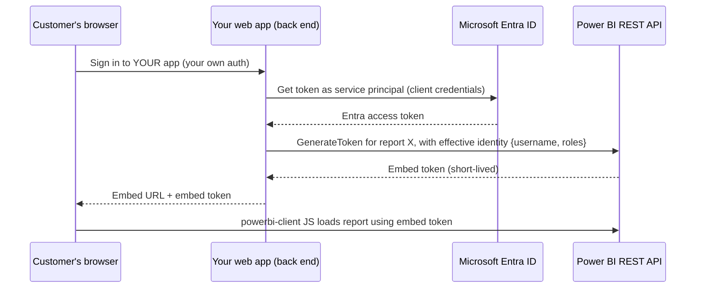

# 05 · Embedding Power BI

Embedding puts Power BI content inside another application: a SharePoint page, a Teams tab, an
internal portal, or a product your customers use. The options differ mainly in **who
authenticates** and **who pays for the capacity**. This lesson maps the options and walks through
the architecture of app-owns-data embedding, the one that requires real engineering.

## The options

| Option | Readers sign in with | Licensing (general) | Coding |
|--------|---------------------|---------------------|--------|
| **Teams / SharePoint Online** web part | Their own organizational account | Readers need access like any Power BI user | None |
| **Secure embed** (Embed → Website or portal) | Their own account, prompted in the iframe | Same as above | Paste an iframe |
| **Embed for your organization** ("user owns data") | Their own Microsoft Entra ID account, via your app | Readers need Pro/PPU or content in capacity | JavaScript + Entra app registration |
| **Embed for your customers** ("app owns data") | *Your app's* identity; users never see Microsoft sign-in | Your organization provides capacity (an embedding-capable SKU) | Back-end + JavaScript |
| **Publish to web** | Nobody — public | — | Public link; never for private data |

Pricing and SKU names change; check current documentation for which capacity SKUs support
app-owns-data embedding.

## App owns data: the architecture



Key points:

- Your back end authenticates to Microsoft Entra ID as a **service principal** (an app registration
  with a client secret or certificate) — or a master user account, which Microsoft discourages for
  new solutions.
- The service principal is added as a member of the workspace, and a tenant setting must allow
  service principals to use Power BI APIs.
- For each page view, your back end calls the REST API's **GenerateToken** endpoint with the report
  and semantic model IDs and, if the model has RLS, an **effective identity**: a username (any string
  your app chooses, e.g. a customer ID) and the role(s) to apply.
- The browser uses the **powerbi-client** JavaScript library to render the report in a `div` using the
  embed token.

### Worked example: RLS per customer

The model has a role `Customer` on `DimCustomer`:

```dax
[CustomerCode] = USERNAME ()
```

In app-owns-data embedding, `USERNAME()` (and `USERPRINCIPALNAME()`) return the **username you put
in the effective identity** — not a Microsoft account. Your back end, after authenticating customer
"ACME-042" in its own login system, requests an embed token with:

```json
{
  "datasets": [{ "id": "<semantic-model-id>" }],
  "reports":  [{ "id": "<report-id>" }],
  "identities": [{
    "username": "ACME-042",
    "roles": ["Customer"],
    "datasets": ["<semantic-model-id>"]
  }]
}
```

With the Trailhead-style data, if `ACME-042`'s orders total 1,250 and all customers total 9,800, the
embedded report shows 1,250 — and no filter in the browser can reveal the 9,800, because the role is
applied in the engine before any query. The security boundary is your back end: **never let the
browser choose the username**.

### Front-end snippet

```javascript
import * as pbi from "powerbi-client";

const powerbi = new pbi.service.Service(
  pbi.factories.hpmFactory, pbi.factories.wpmpFactory, pbi.factories.routerFactory
);

const { embedUrl, embedToken, reportId } = await fetch("/api/embed-info").then(r => r.json());

powerbi.embed(document.getElementById("report"), {
  type: "report",
  id: reportId,
  embedUrl,
  accessToken: embedToken,
  tokenType: pbi.models.TokenType.Embed,
  settings: { panes: { filters: { visible: false } } }
});
```

Embed tokens expire; refresh them before expiry by calling your API and `report.setAccessToken(...)`.
The exact package imports vary by version and bundler; follow the library's current README.

## How It Actually Works

The embed token is a signed, short-lived credential the Power BI service issues to your service
principal, scoped to specific items (reports, models) and carrying the effective identity and roles you
supplied. The iframe that powerbi-client creates loads the Power BI report host, which presents the
token with every request. The service validates it and, when executing the report's DAX queries,
connects to the semantic model **as that effective identity with those roles** — exactly the same RLS
mechanism as lesson 08 of Level 2, but with the identity asserted by your application rather than by a
Microsoft sign-in.

That's why app-owns-data shifts responsibility: Power BI trusts your back end to assert the right
username. If your API accepts a customer ID from the browser and passes it through, any user can view
any customer's data. The capacity is also yours — every customer's queries consume your capacity's
compute, so load testing belongs in the plan.

## Common mistakes

- Using Publish to web for "internal" dashboards.
- Letting the client choose the effective identity.
- Using a personal "master user" account that has MFA prompts, password expiry, or leaves the company.
- Forgetting that report authors viewing in the workspace bypass RLS; test through the embedded path.

## Exercise

1. List which embedding option fits each: an intranet page for 50 employees; a Teams channel; a
   customer portal with 2,000 external users; a public COVID-style statistics page with open data.
2. Draw the token flow for app-owns-data from memory and mark the security boundary.
3. If you have an Azure subscription and a suitable capacity, follow Microsoft's embedding sample for
   your language, and add an effective identity with an RLS role. Otherwise, write the pseudo-code for
   your `/api/embed-info` endpoint, showing where the customer ID comes from.
