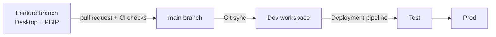

# 07 · CI/CD with PBIP & Git Integration

A `.pbix` file is a binary ZIP. Git can store it, but it can't show you what changed, and two
people editing it can't merge their work. The **Power BI Project (PBIP)** format saves a report and
model as a folder of text files instead, which makes normal software practice possible: diffs, code
review, branches, and automated checks before deployment.

!!! note "Evolving feature set"
    PBIP, the TMDL model format, the enhanced report format (PBIR), and workspace Git integration
    have moved through preview to general availability at different times, and file layouts have
    changed along the way. The structure below reflects the general shape at the time of writing.
    Check Microsoft's current documentation for exact file names and which options are GA.

## Saving as a project

1. In Desktop, enable the relevant options if your release still lists them under **File → Options
   and settings → Options → Preview features** (for example *Power BI Project (.pbip) save option*,
   *Store semantic model using TMDL format*). In newer releases some are on by default.
2. **File → Save as** → choose type **Power BI project files (*.pbip)**.

You get a folder like:

```text
TrailheadSales/
├── TrailheadSales.pbip                 # small pointer file you open in Desktop
├── TrailheadSales.SemanticModel/
│   ├── definition.pbism
│   └── definition/                     # TMDL: one file per table, plus model-level files
│       ├── model.tmdl
│       ├── relationships.tmdl
│       ├── roles/
│       │   └── Region Managers.tmdl
│       └── tables/
│           ├── FactSales.tmdl
│           ├── DimProduct.tmdl
│           └── Date.tmdl
├── TrailheadSales.Report/
│   ├── definition.pbir                 # points at the semantic model
│   └── ...                             # report layout (report.json or a PBIR folder)
└── .gitignore                          # excludes local caches/data
```

The local data cache (`.pbi/cache.abf`) is excluded by the generated `.gitignore`: source control
holds **definitions**, not data.

## TMDL: the model as readable text

A table file looks like this (abridged):

```text
table FactSales

	measure 'Sales Amount' = SUM ( FactSales[Amount] )
		formatString: #,0.00
		displayFolder: Sales

	measure 'Achievement %' = DIVIDE ( [Sales Amount], [Target Amount] )
		formatString: 0.0%

	column Amount
		dataType: decimal
		summarizeBy: none
		sourceColumn: Amount

	partition FactSales = m
		mode: import
		source =
				let
				    Source = Sql.Database(ServerName, DatabaseName),
				    Sales = Source{[Schema="dbo",Item="FactSales"]}[Data]
				in
				    Sales
```

TMDL (Tabular Model Definition Language) uses indentation (tabs) for structure. Changing one measure
changes a couple of lines in one file — which is exactly what makes review possible.

## Worked example: reviewing a change

A colleague changes `Achievement %` to zero-fill, as in Level 3, lesson 09. The pull-request diff
shows:

```diff
-	measure 'Achievement %' = DIVIDE ( [Sales Amount], [Target Amount] )
+	measure 'Achievement %' = DIVIDE ( [Sales Amount] + 0, [Target Amount] )
 		formatString: 0.0%
```

The reviewer can see exactly what changed, ask "which cells change?" and expect the answer: February
Apparel and March Accessories go from blank to 0.0%; nothing else. Compare that with reviewing a
binary `.pbix` — you'd have to open both versions and click around.

## Workspace Git integration

Fabric/Power BI workspaces can connect to a Git repository (Azure DevOps and GitHub are supported
providers; check current docs for specifics):

1. Workspace **settings → Git integration** → choose provider, repository, branch and folder.
2. The workspace shows each item's status: *Synced*, *Uncommitted changes*, *Update required*.
3. **Commit** pushes changes made in the service (e.g. web-edited model) to the branch; **Update**
   pulls commits from the branch into the workspace.

A common flow:



Developers work in Desktop on a feature branch (or in a branched-out workspace), open a pull request,
automated checks run, a reviewer approves, the merge updates the Dev workspace, and deployment pipelines
promote to Test and Prod (Level 3, lesson 09).

## Automated checks (CI)

Because the model is text, a CI pipeline can inspect it. Useful checks, from easiest to hardest:

1. **Lint rules on TMDL files** — e.g. every measure has a `formatString`; no measure named
   `Measure 1`; `summarizeBy: none` on key columns. A short script can grep for these.
2. **Best Practice Analyzer** — Tabular Editor's rule engine (with community rule sets) can run from the
   command line against the model definition and fail the build on errors: bidirectional relationships
   without justification, floating-point data types for currency, unhidden foreign keys, and so on.
3. **DAX query tests** against a deployed test model through the XMLA endpoint (capacity/PPU) — the
   subject of lesson 09.

A minimal lint in a CI step (bash), checking that every measure declares a format string:

```bash
#!/usr/bin/env bash
set -euo pipefail
fail=0
for f in TrailheadSales.SemanticModel/definition/tables/*.tmdl; do
  measures=$(grep -cE $'^\tmeasure ' "$f" || true)
  formats=$(grep -cE $'^\t\tformatString:' "$f" || true)
  if [ "$measures" -ne "$formats" ]; then
    echo "::error file=$f::$measures measures but $formats formatString lines"
    fail=1
  fi
done
exit $fail
```

(It's a heuristic — it counts lines, so a column with a format string would confuse it — but it shows
the idea: the model is now something your tooling can read.)

## How It Actually Works

A semantic model is, underneath, a **Tabular Object Model (TOM)**: a tree of objects (model → tables →
columns, measures, partitions; relationships; roles; perspectives; cultures) with properties. The
`.pbix` stores it inside a binary Analysis Services backup together with the data. PBIP instead
serializes the same TOM tree into text — historically as a single JSON file (`model.bim`, the
Tabular Model Scripting Language), and with TMDL as a folder of indented files, one per table/role, so
that diffs are small and merges rarely conflict.

When Desktop opens a PBIP, it deserializes the TMDL into TOM, loads it into its local Analysis Services
instance, and — because the data cache isn't in Git — asks you to refresh to repopulate data. Git
integration in the service does the same in the cloud: an *Update* deserializes the repository's
definition and applies it to the workspace's model (a metadata change; data needs a refresh if the
structure changed), and a *Commit* serializes the workspace model back to files.

## Common mistakes

- Committing the data cache or credentials — keep the generated `.gitignore`, never hard-code secrets
  in M (use parameters and service-side credentials).
- Two people editing the same report page in parallel; model files merge well, report layouts less so.
- Treating Git sync as a deployment tool to production; use pipelines or controlled deployments.
- Lint rules nobody fixes; fail the build only on rules the team has agreed to enforce.

## Exercise

1. Save your Level 2 project as PBIP, initialize a Git repository, commit, change one measure's format
   string, and look at `git diff`.
2. Write three lint rules for your team as plain English, then implement one as a script.
3. If you have a capacity workspace, connect it to a repository and practise Commit and Update with a
   change made in Desktop and a change made in the service.
